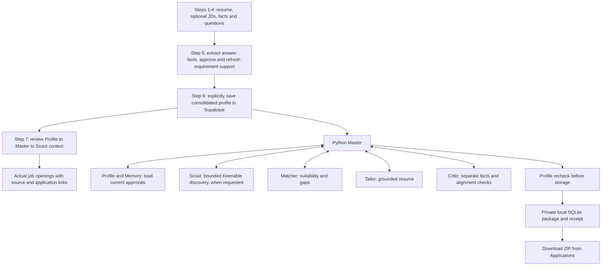

# Run Career Scout from resume to actual job openings

The local app now connects the existing Profile intake and explicit approvals to
the Python Master workflow, real Gemini/Keenable adapters, and private local
application storage. Fact and Profile Builder prepare validated source-backed
profile data; Master sends that saved profile to Scout for actual vacancy
discovery. There is no generated-role approval stage. The hosted Site still runs
its previously deployed version.

## Start

Double-click `Start-Scout.cmd` in the repository root, or run `Start-Scout.ps1`.
It launches both the Python service and the web app. Open
http://127.0.0.1:5173/ and use the local sign-in flow. Keep the launcher running.
`npm run dev` starts only the web app; use the root launcher for the full pipeline.

The existing ignored `.env.local` supplies `GEMINI_API_KEY`, `SUPABASE_URL`,
`SUPABASE_SECRET_KEY` (or `SUPABASE_SERVICE_ROLE_KEY`), and `KEENABLE_API_KEY`.
Pinecone is optional for this pipeline; authoritative approvals come from Supabase.
The launcher generates a private, temporary token between the two local servers.
No new key, paid fallback, or hosted deployment is required for local execution.

If the Python environment is absent, follow `backend/README.md` to run
`uv sync --locked` in `backend/`. The root launcher uses that environment.

## When and where to provide documents

| Input | Where | When | Required? |
| --- | --- | --- | --- |
| Your resume | **My profile → Add your resume and JDs** | First, before analysis | Yes. Upload PDF, DOCX or TXT, or paste text. |
| Example job descriptions for shaping your profile | Optional job-description area in the same intake step | Before JD requirement analysis; add more later if needed | No. Resume-only works. The guided flow supports 1–15 optional JDs via upload, paste or public link. |
| Clarifications about your experience | **My profile → Questions** | When Builder identifies missing or unclear information | Only when relevant; answers become fact proposals for review. |
| The specific job you want to apply for | **Applications → Use a specific job** | After reviewing facts and saving the consolidated master profile | Provide the title, company, HTTPS application link and full JD. Choosing **Prepare application** in a Jobs detail dialog fills these fields. |

Use **Analyze** in the resume step and review individual fact proposals. The
local workflow now has seven explicit steps; saving the complete profile and
starting research are separate actions. Job requirements never become user
experience or automatic approvals.

| Step | What to do | What it produces |
| --- | --- | --- |
| 1. Add your resume and JDs | Upload/paste your resume and optional example JDs, then analyze. | Private source documents and fact proposals. |
| 2. Review your resume facts | Approve, reject, correct or resolve each relevant fact. | Versioned, source-linked factual decisions. |
| 3. Analyze JDs and prepare questions | Compare every selected JD requirement with your approved facts. | Source-backed requirement assessments and targeted questions, without AI role cards. |
| 4. Answer the missing-experience questions | Respond to material JD gaps and save your goals/preferences. | Saved responses; a Yes still needs a factual example before it establishes experience. |
| 5. Review answers and update your profile | Extract facts from saved answers, review new facts and refresh the requirement comparison. | Approved answer evidence incorporated into the profile, with remaining gaps explicit. |
| 6. Build and save consolidated profile | Review the complete profile preview and click **Build & save consolidated profile**. | A saved `profile-N` version and a downloadable consolidated profile. |
| 7. Send to Master and Scout | Review the saved master-profile handoff, then click **Send to Master & start job research**. | A recorded dispatch and actual job openings with source/application links. |

Step 5 shows whether each latest answer needs details, extraction, fact approval
or conflict resolution. Pending Yes details, unfinished answer extraction,
unreviewed answer facts and conflicts prevent a complete save. New evidence can
require refreshing the JD requirement comparison. No, deferred and declined
responses can remain explicit qualification gaps; the app does not fill them in.

Step 6 combines approved resume and questionnaire facts with professional
sections, explicit source titles, source references and requirement support
or gaps. The professional summary consists of approved source statements;
generated role summaries are excluded. Saving requires
your explicit click; reviewing a preview does not approve facts or save a new
version. Facts, reviewed answers, JD assessments, source-derived search terms and preferences are bound to the
saved profile. Later changes require another review/save before Master can use
the current profile.

Step 7 displays the saved profile version, responsibilities, industry knowledge,
skills/tools, qualifications, preferences and planned search routes. This preview
does not run a search. **Send to Master & start job research** opens Jobs and
starts one search from that saved context. **Open search filters** opens Jobs
without starting research. The handoff card distinguishes preview, dispatched,
completed and failed states and reports whether its receipt was saved. You can
inspect the source coverage and handoff record. Employment titles come only from
explicit approved title fields. A title copied from a selected JD is labelled
employer target context, never experience you possess. If no title is provided,
Scout can use responsibility and skill routes without inventing one. Legacy
generated role names, alternate titles, keywords and summaries are excluded from
the consolidated artifact and search context even if approved in an older flow.

For multiple JDs, approve your resume facts first, then use **Analyze JDs & prepare
questions**. Profile Builder analyzes every selected document, compares its
requirements with approved facts, and opens **Review missing experience** when
answers are needed. Save Yes with your own example, say No, or defer. You can also
confirm Yes and add an example later; a bare Yes is saved as needing details and
does not establish experience. Short factual answers are accepted. New facts
still need your review and approval. Then rebuild the comparison
in step 5 to update requirement support and reuse the newly approved evidence. See
[the Builder interview workflow](profile-workflow.md#multi-jd-profile-builder-interview-local-update-2026-10-30).

Your response is saved before Fact Agent starts extracting facts. If Gemini is
temporarily unavailable or has reached quota, the card says your answer is saved
and offers **Extract facts from my saved answer**. Use that control after the
provider is available; do not retype a successfully saved response. Replaying an
interrupted save returns the original answer rather than adding a duplicate.
If the app reports that your profile changed, reload before submitting a new
answer. Your existing approvals remain in place.

Open **Review your facts**, then expand **Fact Agent: structured resume review
and missing information** to inspect personal details, each job, education,
certifications and skills. Missing fields are labelled explicitly. Employment
totals merge overlapping dates while preserving the individual jobs. The review
states whether the result is calendar-month coverage or exact-day coverage and
whether date facts still need approval. Missing, conflicting or imprecise dates
can prevent an accurate total; user confirmation alone is not independent
verification.

Local Fact, Profile Builder and Scout instructions are read from their editable
`backend/src/career_scout/agents/*/prompt.md` files through the running Python
service. Restart with the root launcher if an older service cannot load these
instructions. Hosted instructions update only through a new deployment.

## Prepare a package

The separate Applications workflow uses the saved consolidated master profile.
Open **Applications** and choose either:

1. **Use a specific job**: paste its actual JD and application details, or select
   **Prepare application** from a discovered/imported job's detail dialog.
2. Profile-based discovery: Scout runs bounded Keenable
   discovery from source-checked professional terms; Matcher selects a supported
   job from its returned shortlist.

Profile-linked discovery starts with the past seven days and can expand to
thirty days if strong recent results are sparse. Its independent routes use
titles, performed responsibilities/industry and specialist skills/function when
approved context is available. One invocation uses at most six search requests
and ten page checks. It reports missing context and unknown posting dates,
excludes known closed/expired jobs and checks official application sources.
Unknown qualifications remain review items. Saved owner-scoped history can
suppress unchanged recommendations and identify updates. Raw resume text and
contact information are not sent as search queries. Manual Jobs searches retain
their existing controls.

Click **Prepare application package**. Progress shows profile loading, discovery
when requested, matching, tailoring, independent fact/alignment reviews, and
storage. Unsupported mandatory qualifications or unresolved reviews produce
`needs_review`, not a ready package. Correct or clarify your profile and start a
new run when needed.

Critic failures return through Master to Tailor for up to two revisions. Each
revised draft must receive a matching new review. `ready_to_apply` means the
reviewed package has been stored; application submission is your own action.

## Results, recovery and data

**Download validated package** returns a ZIP with a dated directory containing:

- `tailored-resume.md` and `tailored-resume.txt`;
- `job.json`, `job-description.md` and `application-link.txt`;
- `match-assessment.json`, `validation.json` and `manifest.json`.

The private local journal and packages live in `.local/pipeline/runs.sqlite3`.
They are ignored by Git, excluded from deployment, and blocked from the dev
server's static file access. The download endpoint scopes access to the signed-in
owner. Packages remain on this computer; they are not synced between devices.
Use **Delete run and package** in Applications to remove a local run and its data.
Profile deletion and application-package deletion are separate controls.

If the app closes, restart the launcher, open Applications and choose the run.
Use **Resume run** for interrupted/failed/cancelled work. Completed tool results
are checkpointed and reused; Profile/Memory always reloads current approvals.
An in-flight external call interrupted before its result was journaled may run
again. There are no automatic provider retries, daily scheduler, or global daily
model quota in this local release. Concurrent runs are bounded to one per owner
and two per service.

The final Profile recheck and local package write use separate stores. They are
not one cross-database transaction. Hosted production deployment, atomic hosted
revision enforcement and representative real-user model evaluation remain
separate work.

## Verification

Offline: run the Python tests in `backend/`, the Node tests in `tests/`, TypeScript
checking, and the production build. `scripts/pipeline-smoke.mjs --live` explicitly
runs bounded Gemini/Supabase verification with a disposable synthetic profile and
target job, then purges that synthetic profile. The smoke journal is isolated
under `.local/pipeline-smoke/`. `scripts/pipeline-scout-check.mjs --live` runs one
bounded Keenable batch with generic criteria and no resume/profile data.

Synthetic verification does not establish accuracy on your own resume or jobs.

The seven-step completion and handoff changes are local. A saved receipt or
offline fixture check does not establish successful live search, model quality,
hosted publication or full browser/mobile verification. No real-user approval or
consolidated-profile save is implied by implementation work.

The current source-only workflow correction has not, by itself, made a live
model or job-search request or changed the real user's saved fact approvals.
Full regression/build and provider/browser checks are recorded separately when
performed.

The 2026-10-30 questionnaire check saved and replayed a disposable synthetic
answer successfully. Gemini extraction was temporarily unavailable, and the
saved-answer recovery receipt was verified; the synthetic profile was purged.
This verifies recovery from that provider failure, not successful live Fact
extraction for the repaired flow. Full browser/mobile verification and hosted
publication of the current changes remain separate.
