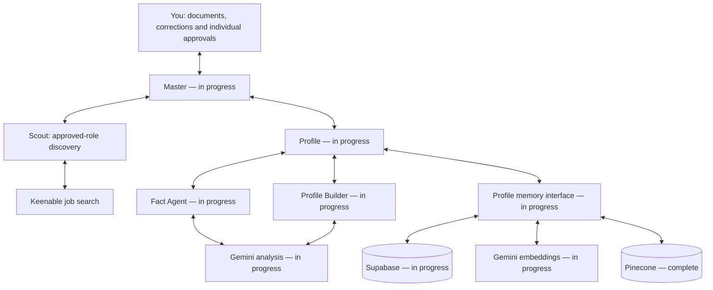

# Profile Agent: structure and reviewed progress

Reviewed 2026-11-03; record revision 2026-11-03.5. Generated from the same task mapping and reviewed record as /profile/architecture. States summarize tracked acceptance; they are not live health checks. There are 41 distinct items in the diagram, including Master dispatch; shared items are counted once.

Current route: resume ? Factual Profile ? optional per-role work/skill questionnaires ? explicit approval of additions (separate approval for revised wording) ? one validated Final Profile ? Profile ? Master ? Scout ? Keenable. JDs prompt discovery of actual experience; they never establish user capabilities. Unapproved drafts and rejected claims stay outside confirmed profile content. Existing source and approval gates apply to final saving.

Gemini provides analysis and embeddings. Supabase remains authoritative; Pinecone is a derived semantic index. Profile's memory interface mediates all storage and vector operations. Children cannot access memory or communicate directly. Model output is a proposal; only the user approves real facts and role profiles. JD requirements are not evidence of user experience.

## Layer status and work

### Master

Routes requests and approved results. The local Python pipeline now connects current-profile loading, bounded discovery, matching, tailoring, independent Critic checks and local validated packages. Hosted Python deployment and representative user validation remain separate.

- **in progress** — Production dispatch and scoped payloads (`master-routing`)
- **complete** — Pass the saved master profile to Scout (`master-profile-scout`) Evidence: 2026-10-29: 152 automated tests and TypeScript passed; 10 actual Profile/Scout component scenarios passed with synthetic state. One live Gemini resume-builder request produced three valid proposed roles from synthetic approved facts, without JDs, real approvals or personal profile reads.
- **complete** — Master dispatch for guided profile intake and criteria (`master-guided-intake`) Evidence: 2026-10-29: 152 existing backend tests and 15 new guided/link/dispatch cases passed. Ten guided workspace-component scenarios passed against synthetic ProfileService persistence; five Scout and eight diagram component regressions passed. One live synthetic Gemini request returned two valid proposed roles. Desktop intake/link/embedded Jobs layout inspected; full real-user/mobile evaluation remains tracked separately.
- **complete** — Python orchestrator, agent prompts and typed tool foundation (`master-python-foundation`) Evidence: 2026-10-29: 35 Python tests and 167 existing JS tests passed. Tests cover JS route parity, optional JDs, source evidence, approval stops, scoped inputs, independent review/storage gates, bounded revisions, stale/malformed outputs, per-run budgets/owners and timeouts. Ruff, locked offline sync, CLI and wheel checks passed. Provider implementations remain unbound and the Python service is not deployed.
- **in progress** — Connect production adapters to Python contracts (`master-python-adapters`)
- **in progress** — Deploy authenticated durable Python service and web bridge (`master-python-service`)

### Profile

Owns one current factual profile. Builder approvals are saved immediately and verified by reloading Supabase. Master requests the latest resume-sourced information and approved additions through Profile; there is no separate Final Profile save step. Existing Fact/Builder extraction and decisions are unchanged.

- **complete** — Nested Profile coordination foundation (`profile-subgraph`) Evidence: Actual nested LangGraph graph and audit-route tests.
- **complete** — Bounded document extraction (`profile-document-parsers`) Evidence: DOCX/table/PDF/TXT and adversarial parser tests in tests/profile.test.mjs.
- **in progress** — Read your master resume (`profile-ingest`): Verify hosted Gemini configuration and representative extraction, review, reuse and retrieval workflows.
- **in progress** — Approve your factual career profile (`profile-approval`): Verify the repaired signed-in approval flow with the user; existing rejected facts require explicit review/re-approval.
- **in progress** — Consolidate approved profile outputs (`profile-consolidation`): Verify hosted Gemini configuration and representative extraction, review, reuse and retrieval workflows.
- **in progress** — Profile export, withdrawal and deletion (`profile-data-lifecycle`): Hosted storage/deletion integration verification pending.
- **in progress** — Profile browser and interaction review (`profile-browser-review`): Complete desktop/mobile interaction review, including the new structural diagram and end-to-end authenticated Profile flows. Browser extension access is unavailable; native desktop access is partial.
- **complete** — Profile structural diagram and status view (`profile-architecture-board`) Evidence: Diagram model reference/coverage tests, TypeScript and eight React SSR/component interaction checks. Browser layout and full Profile flows remain separately tracked.
- **complete** — One profile-first guided workspace (`profile-guided-workspace`) Evidence: 2026-10-29: 152 existing backend tests and 15 new guided/link/dispatch cases passed. Ten guided workspace-component scenarios passed against synthetic ProfileService persistence; five Scout and eight diagram component regressions passed. One live synthetic Gemini request returned two valid proposed roles. Desktop intake/link/embedded Jobs layout inspected; full real-user/mobile evaluation remains tracked separately.
- **in review** — Save Final Profile with automatic guarded comparison refresh (`profile-automatic-final-save`): Real-user save interaction and representative live-model refresh acceptance remain outstanding. Hosted deployment and visual browser acceptance remain separate. Current resume analysis and pending factual decisions must be completed explicitly before a new validated Final Profile and live handoff can be accepted. Evidence: 2026-11-01: Full Node regression suite, 22 dedicated automatic-save checks, TypeScript and production build passed. Tests cover current-comparison reuse, new-JD-only refresh and assembly, changed facts/prompts, source coverage, required responses, pending extraction/facts, conflicts, deletion/indexing, missing model, provider/storage failure, concurrent edits, receipt tampering, unchanged retries, excluded drafts/rejections and no Scout dispatch. Read-only local preflight found three legacy comparisons needing binding refresh and no manual blockers; eight protected Fact/ingestion/view files stayed byte-identical. Local page/client modules returned HTTP 200. No real-profile save, real approval, live model request, hosted deployment or visual browser acceptance was performed. 2026-11-01: All 26 targeted save/status tests and TypeScript passed. Rendering checks cover historical stale saves, validated version matching, empty/loading/invalid timestamps and New York daylight-saving transitions. Authenticated local page and status module returned HTTP 200; read-only profile retrieval retained revision 194. No profile writes, model calls, hosted deployment or visual browser interaction were performed. 2026-11-03: All 622 Node tests, 43 Python tests, TypeScript and production build passed. Synthetic tests verify Builder approvals through durable save/reload and the same Master/Scout version/content hash; rejected and draft claims remain excluded. Coverage includes pending resume analysis/facts, storage acknowledgement without contents, corrupted reloads, failed reload/retry, concurrent additions, withdrawn evidence, legacy bypass attempts, preserved source terms and rendered readiness states. An isolated real-state replay stopped before writes or model calls. Authenticated local reads confirmed the complete saved record was unchanged; all 16 protected Fact/Builder code, prompt, policy and view files were byte-identical. Local page/modules returned HTTP 200. Python emitted only a cache-write warning. No real approvals, model/search calls, real-profile save, Git push, hosted deployment or visual browser interaction acceptance is claimed.
- **in review** — Use one current profile with verified Builder saves and Master-to-Scout retrieval (`profile-current-record-handoff`): Real-user interaction acceptance and visual browser click-through remain outstanding. Hosted publication and a user-initiated live job search are separate; neither is claimed by local tests. Evidence: 2026-11-03: All 633 Node tests, 49 Python tests, TypeScript and Ruff passed. Tests cover exact approvals through save/reload to Master and Scout, resume-only research without reapproval/finalization, rejected and draft exclusions, separately approved revisions, failed writes/read-backs, retry idempotency, stale dispatches, unavailable sources, foreign approvals, forged context, JSONB ordering, Python boundary contracts and rendered UI. Authenticated live read-only checks after restarting the local app returned HTTP 200 for profile preview, old-bookmark preview, the page and compiled workspace; the Python pipeline is healthy. All six existing approved Builder additions are available alongside 55 professional resume-source records. The complete real profile remains identical at revision 194 and all 16 protected Fact/Builder files are unchanged. No real approval, profile write, model request or job search occurred. The final production build completed with exit code 0; seven progress/architecture checks also passed.

### Fact Agent

Reads its editable prompt and accounts for every resume passage. Section 1 groups factual records and separate employment stints; Section 2 organizes atomic responsibilities and achievements. Structured review flags missing fields and calculates source-precise employment duration without double-counting overlaps. User approval remains separate; it cannot infer experience from a JD or access memory directly.

- **in progress** — Personal and contact facts (`fact-personal`): Verify hosted Gemini configuration and representative extraction, review, reuse and retrieval workflows.
- **in progress** — Employment facts and dates (`fact-employment`): Verify hosted Gemini configuration and representative extraction, review, reuse and retrieval workflows.
- **in progress** — Education and degree facts (`fact-education`): Verify hosted Gemini configuration and representative extraction, review, reuse and retrieval workflows.
- **in progress** — Approved skills and factual record (`fact-records`): Verify hosted Gemini configuration and representative extraction, review, reuse and retrieval workflows.

### Profile Builder

Uses the Factual Profile as its source of truth. Each supplied JD has separate work-experience and skills tables. Approve saves the exact statement; Reject excludes it; Somewhat saves a draft requiring a separate approval of revised wording. Profile alone persists approved additions and preserves existing fact versions. Job postings are context, never evidence of user experience. Confirmed additions are immediately available in the current stored profile used by Master and Scout. No separate Final Profile save is required.

- **in progress** — Intake 10–15 selected job descriptions (`builder-intake`): Verify hosted Gemini configuration and representative extraction, review, reuse and retrieval workflows.
- **in progress** — Extract role requirements (`builder-requirements`): Verify hosted Gemini configuration and representative extraction, review, reuse and retrieval workflows.
- **in progress** — Confirm actual task experience (`builder-confirmation`): Verify hosted Gemini configuration and representative extraction, review, reuse and retrieval workflows.
- **in progress** — Save the source-backed professional profile (`builder-profiles`): Verify hosted Gemini configuration and representative extraction, review, reuse and retrieval workflows.
- **complete** — Consolidate approved resume facts without JDs (`builder-resume-only`) Evidence: 2026-10-29: 152 automated tests and TypeScript passed; 10 actual Profile/Scout component scenarios passed with synthetic state. One live Gemini resume-builder request produced three valid proposed roles from synthetic approved facts, without JDs, real approvals or personal profile reads.
- **complete** — Read optional JD pages and document links (`builder-jd-link-intake`) Evidence: 2026-10-29: 152 existing backend tests and 15 new guided/link/dispatch cases passed. Ten guided workspace-component scenarios passed against synthetic ProfileService persistence; five Scout and eight diagram component regressions passed. One live synthetic Gemini request returned two valid proposed roles. Desktop intake/link/embedded Jobs layout inspected; full real-user/mobile evaluation remains tracked separately.
- **complete** — Build from a resume with zero or one optional JD (`builder-guided-single-jd`) Evidence: 2026-10-29: 152 existing backend tests and 15 new guided/link/dispatch cases passed. Ten guided workspace-component scenarios passed against synthetic ProfileService persistence; five Scout and eight diagram component regressions passed. One live synthetic Gemini request returned two valid proposed roles. Desktop intake/link/embedded Jobs layout inspected; full real-user/mobile evaluation remains tracked separately.
- **in review** — Per-role experience and skills expansion with a separate revision approval (`builder-role-expansion`): The first supplied LinkedIn job ID remains unavailable. User review of generated questionnaires and real decision interaction remains outstanding; no answers were auto-approved. Three comparisons remain unresolved (financial-return metrics, investor due diligence and daily risk-control processes); they remain visible without a match claim or approval controls. Evidence: 2026-11-01: 571 Node tests and TypeScript passed. A live Gemini refresh saved 43 comparisons with 32 recorded requirements, six skipped/deferred items and three unresolved comparisons. The reported collaboration/reporting example is now an estimated 85% minor-gap skip, with its uncertain audience retained as unconfirmed; communication is covered. Nine proposed/invalid comparisons received independent review. Isolated real-source replay retained a genuinely missing mandatory-tool control as a question. Facts, approvals and eight protected Fact/ingestion/view files remained identical. No hosted deployment or user decisions were performed; representative semantic-quality and user interaction acceptance remain outstanding.

### Gemini analysis

Gemini 3.1 Flash-Lite returns constrained JSON for extraction, JD analysis, role building and assessment. Code validates source evidence; you approve individual versions.

- **complete** — Gemini analysis adapter (`profile-gemini-analysis`) Evidence: Gemini request/response, malformed/truncated/refused output, quota preservation and actual Workers transport tests; local live synthetic facts passed.
- **in progress** — Activate hosted profile providers (`profile-provider-activation`): Verify Gemini model execution and the complete Profile workflow in the authenticated hosted user session.
- **in progress** — Evaluate profile extraction and semantic retrieval (`profile-embedding-evaluation`): Complete representative model-quality and authenticated hosted workflow evaluation; bounded synthetic checks do not establish full real-profile readiness.

### Profile memory interface

Profile alone reads and writes memory. Keyword retrieval stays available when embeddings are paused, missing or quota-limited.

- **in progress** — Profile-owned memory interface (`profile-memory-interface`): Verify hosted Gemini configuration and representative extraction, review, reuse and retrieval workflows.
- **complete** — Define permanent storage and retrieval (`memory-design`) Evidence: Approved architecture; executable SQL migration and local PostgreSQL permission/revision tests; docs/profile-workflow.md.
- **in progress** — Implement permanent profile memory (`memory-implementation`): Verify hosted Gemini configuration and representative extraction, review, reuse and retrieval workflows.
- **complete** — Saved-profile orchestration contract (`profile-reuse-contract`) Evidence: Actual LangGraph saved-profile and whole-workflow reuse tests pass with fixture data.
- **complete** — Keyword retrieval without model access (`profile-keyword-fallback`) Evidence: No-request pause/missing-key checks, Gemini-quota fallback and current-approved-record rehydration tests.

### Supabase

Stores originals, source passages, factual proposals, approvals, role profiles, immutable snapshots and recovery history.

- **in progress** — Private career document storage (`profile-storage`): Verify hosted Gemini configuration and representative extraction, review, reuse and retrieval workflows.
- **complete** — Supabase schema and access migration (`profile-supabase-migration`) Evidence: Actual PostgreSQL migration executed twice in PGlite; direct anon/service table access denied, revision conflicts and owner isolation tested.

### Gemini embeddings

Gemini Embedding 001 converts approved passages and search queries into vectors. A new per-owner namespace keeps Gemini and legacy OpenAI vectors separate.

- **complete** — Gemini embeddings and vector isolation (`profile-gemini-embeddings`) Evidence: Document/query task types, dimensions, unchanged-record reuse, namespace migration and same-host dual-namespace purge tests; local live synthetic embeddings passed.
- **in progress** — Activate hosted profile providers (`profile-provider-activation`): Verify Gemini model execution and the complete Profile workflow in the authenticated hosted user session.
- **in progress** — Evaluate profile extraction and semantic retrieval (`profile-embedding-evaluation`): Complete representative model-quality and authenticated hosted workflow evaluation; bounded synthetic checks do not establish full real-profile readiness.

### Pinecone

Searches vectors by meaning. Matches are reloaded from current approved Supabase records; similarity cannot approve a claim or establish a qualification.

- **complete** — Pinecone 3072-dimension transport (`profile-vector-transport`) Evidence: Live synthetic transport test passed; test namespace cleanup requested. Embedding API calls: zero.
- **complete** — Gemini embeddings and vector isolation (`profile-gemini-embeddings`) Evidence: Document/query task types, dimensions, unchanged-record reuse, namespace migration and same-host dual-namespace purge tests; local live synthetic embeddings passed.

## Current provider contract

- Analysis: gemini-3.1-flash-lite. Embeddings: gemini-embedding-001, 3072 dimensions, document/query retrieval task types.
- Profile ignores legacy OpenAI keys and endpoint overrides; no paid fallback or automatic retry exists.
- Original files retain their existing owner paths. Gemini vectors use a separate per-owner namespace; different vector spaces are never mixed.
- Approvals, original quotations and saved snapshots are preserved. Legacy index locations remain recorded for explicit deletion.
- Missing/paused/quota-limited semantic search falls back to current approved database keyword evidence.
- Google AI Studio free-tier quotas and data-use terms apply. Keep billing disabled to remain on the free tier; this application does not inspect or change Google billing.

## Recorded validation

- 2026-10-29 — **Profile implementation: local checks**: 109 automated tests, including 31 Profile/PostgreSQL checks, plus TypeScript and production build passed. Seven SSR overview assertions passed; visual/interaction browser QA is unavailable. Live Pinecone synthetic transport passed; Supabase runtime credentials accepted. Hosted migration, OpenAI credentials and real-model evaluation remain pending.
- 2026-10-29 — **Profile provider transport: Workers regression**: Two actual workerd tests pass for profile RPC, health, private download, Pinecone, embedding and model transport using fixtures. Unsupported redirect mode reproduced the original error before networking; manual redirects resolve it while rejecting cross-host redirects. These tests do not establish real model quality.
- 2026-10-29 — **Gemini: initial live synthetic check**: Three local Gemini requests succeeded: source-linked extraction produced four pending synthetic facts; document/query embeddings had 3072 dimensions; reporting-related passages ranked above unrelated equipment text. No stored profile read, personal upload, real approval or OpenAI call. This is a smoke check, not representative full workflow evaluation.
- 2026-10-29 — **Gemini: synthetic JD, Builder and Pinecone flow**: Six Gemini requests passed extraction, one live JD extraction, role proposals and assessment; the JD result was copied onto ten distinct synthetic fixture IDs to exercise onboarding without ten extra calls. Unsupported SQL stayed unmapped, roles stayed proposed, and three synthetic Gemini vectors were searched in an isolated Pinecone namespace. Cleanup requested. No real profile read or real approvals.
- 2026-10-29 — **Profile diagram: local component verification**: 140 automated tests and TypeScript passed. Eight React SSR/component checks passed for nine layers, task selection, configuration presence, polling, offline preservation, recovery, visibility and cancellation. Native Chrome was in active user use and browser-extension access unavailable; visual/mobile/full authenticated browser QA remains pending.
- 2026-10-29 — **Gemini: hosted release verification**: Release 10 deployed successfully with environment revision 3. All 14 HTTP checks passed: Gemini contract, 84-task reviewed record, diagram link, Supabase migration/load reachability and owner/visitor/origin boundaries. No hosted model calls, personal profile reads or browser QA. Source fd6e868ab5cb970926addc7b5d061ccbaade5abc.
- 2026-10-29 — **Profile approval synchronization: synthetic regressions**: All 145 automated tests and TypeScript passed. Eight actual workspace-component scenarios validate late-read protection, exact saved receipt, prior-decision/version guards, duplicate input locking, explicit reject/re-approve, stale-save failure visibility and indexing refresh. Tests use synthetic in-memory state with no user profile writes or model calls. Full browser and real-user decision verification remain pending.
- 2026-10-29 — **Profile resume-only and Master discovery handoff**: 152 automated tests and TypeScript passed. Ten actual component scenarios cover the zero-JD build/approval/activation/link path, manual fallback, preserved location and filters, server-bound snapshot selection and late-load cancellation. One live synthetic Gemini request returned three valid proposed roles. Eight approval and eight diagram component regressions also passed. Desktop local layout and Role profiles navigation were visually inspected; local Supabase networking was restricted, so full authenticated onboarding and mobile review remain unverified. No real user approvals, resume model calls or live Keenable searches were performed.
- 2026-10-29 — **Profile-first guided redesign: synthetic validation**: 152 existing automated checks plus 11 new guided/link-intake/dispatch checks passed. Ten actual guided workspace scenarios passed for zero-JD intake, private upload, unapproved extraction, approval race/conflict safety, role/follow-up proposals, user goals, explicit snapshot activation and embedded Jobs. One live Gemini request with synthetic approved facts returned two proposed roles; no real user approvals, resume model calls or live Keenable searches were performed. TypeScript/build/hosted/browser release verification are separate release checks.
- 2026-10-30 — **Profile Builder prompt and multi-JD interview repair**: Added targeted tests for omitted questions, recurring requirements, unsupported roles, Yes/example approval boundaries, No without positive facts, reused evidence, full multi-JD sequencing, the current prompt and supplemental evidence assessment. A user-requested local comparison completed with full requirement coverage, a matching current prompt fingerprint, saved gap questions and unchanged existing fact approval references. No private source text or answers are included in this record. Hosted publication and full browser interaction QA remain separate.
- 2026-11-01 — **Profile Builder role questionnaire revision**: 2026-11-01: 538 Node regression tests passed, including 8 new Builder persistence/approval cases; TypeScript passed. Keenable retrieved matching Hilco/AQR descriptions. One isolated Gemini attempt failed with provider unavailability; no model comparison result or real-profile write was produced. A final 19 focused checks passed, including UI rendering, draft survival after reanalysis and withdrawn-evidence handling.
- 2026-11-01 — **Profile Builder live questionnaires saved**: 2026-11-01: 546 Node tests and TypeScript passed. Live Gemini-backed comparison saved for two real job descriptions using the current profile. Reload verified 37 pending review items and unchanged factual records/approvals. User interaction acceptance and hosted deployment remain separate.
- 2026-11-01 — **Automatic guarded Final Profile save**: 2026-11-01: Full Node regression suite, 22 dedicated automatic-save checks, TypeScript and production build passed. Tests cover current-comparison reuse, new-JD-only refresh and assembly, changed facts/prompts, source coverage, required responses, pending extraction/facts, conflicts, deletion/indexing, missing model, provider/storage failure, concurrent edits, receipt tampering, unchanged retries, excluded drafts/rejections and no Scout dispatch. Read-only local preflight found three legacy comparisons needing binding refresh and no manual blockers; eight protected Fact/ingestion/view files stayed byte-identical. Local page/client modules returned HTTP 200. No real-profile save, real approval, live model request, hosted deployment or visual browser acceptance was performed.
- 2026-11-01 — **Final Profile last successful save display**: 2026-11-01: All 26 targeted save/status tests and TypeScript passed. Rendering checks cover historical stale saves, validated version matching, empty/loading/invalid timestamps and New York daylight-saving transitions. Authenticated local page and status module returned HTTP 200; read-only profile retrieval retained revision 194. No profile writes, model calls, hosted deployment or visual browser interaction were performed.
- 2026-11-03 — **Verified Final Profile save and same-version Master/Scout handoff**: 2026-11-03: All 622 Node tests, 43 Python tests, TypeScript and production build passed. Synthetic tests verify Builder approvals through durable save/reload and the same Master/Scout version/content hash; rejected and draft claims remain excluded. Coverage includes pending resume analysis/facts, storage acknowledgement without contents, corrupted reloads, failed reload/retry, concurrent additions, withdrawn evidence, legacy bypass attempts, preserved source terms and rendered readiness states. An isolated real-state replay stopped before writes or model calls. Authenticated local reads confirmed the complete saved record was unchanged; all 16 protected Fact/Builder code, prompt, policy and view files were byte-identical. Local page/modules returned HTTP 200. Python emitted only a cache-write warning. No real approvals, model/search calls, real-profile save, Git push, hosted deployment or visual browser interaction acceptance is claimed.

Interactive structure: /profile/architecture. Full reviewed tracker: /progress.
Regenerate this file with `node scripts/profile-architecture-doc.mjs` whenever the reviewed record changes.
