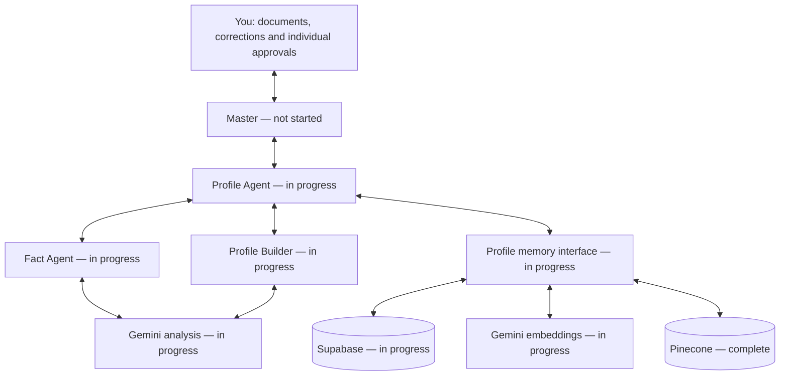

# Profile Agent: structure and reviewed progress

Reviewed 2026-10-29; record revision 2026-10-29.6. Generated from the same task mapping and reviewed record as /profile/architecture. States summarize tracked acceptance; they are not live health checks. There are 29 distinct items in the diagram, including Master dispatch; shared items are counted once.

Gemini provides analysis and embeddings. Supabase remains authoritative; Pinecone is a derived semantic index. Profile's memory interface mediates all storage and vector operations. Children cannot access memory or communicate directly. Model output is a proposal; only the user approves real facts and role profiles. JD requirements are not evidence of user experience.

## Layer status and work

### Master

Routes requests and approved results. Full production dispatch is still a separate deliverable.

- **not started** — Production dispatch and scoped payloads (`master-routing`)

### Profile Agent

Owns intake, individual approvals, corrections, snapshots and the only interface to career memory.

- **complete** — Nested Profile coordination foundation (`profile-subgraph`) Evidence: Actual nested LangGraph graph and audit-route tests.
- **complete** — Bounded document extraction (`profile-document-parsers`) Evidence: DOCX/table/PDF/TXT and adversarial parser tests in tests/profile.test.mjs.
- **in progress** — Read your master resume (`profile-ingest`): Verify hosted Gemini configuration and representative extraction, review, reuse and retrieval workflows.
- **in progress** — Approve your factual career profile (`profile-approval`): Verify hosted Gemini configuration and representative extraction, review, reuse and retrieval workflows.
- **in progress** — Consolidate approved profile outputs (`profile-consolidation`): Verify hosted Gemini configuration and representative extraction, review, reuse and retrieval workflows.
- **in progress** — Profile export, withdrawal and deletion (`profile-data-lifecycle`): Hosted storage/deletion integration verification pending.
- **in progress** — Profile browser and interaction review (`profile-browser-review`): Complete desktop/mobile interaction review, including the new structural diagram and end-to-end authenticated Profile flows. Browser extension access is unavailable; native desktop access is partial.
- **complete** — Profile structural diagram and status view (`profile-architecture-board`) Evidence: Diagram model reference/coverage tests, TypeScript and eight React SSR/component interaction checks. Browser layout and full Profile flows remain separately tracked.

### Fact Agent

Extracts factual assertions with exact quotations. It cannot approve a fact, access memory directly or infer experience from a JD.

- **in progress** — Personal and contact facts (`fact-personal`): Verify hosted Gemini configuration and representative extraction, review, reuse and retrieval workflows.
- **in progress** — Employment facts and dates (`fact-employment`): Verify hosted Gemini configuration and representative extraction, review, reuse and retrieval workflows.
- **in progress** — Education and degree facts (`fact-education`): Verify hosted Gemini configuration and representative extraction, review, reuse and retrieval workflows.
- **in progress** — Approved skills and factual record (`fact-records`): Verify hosted Gemini configuration and representative extraction, review, reuse and retrieval workflows.

### Profile Builder

Proposes role profiles, requirement mappings and useful questions. Initial onboarding uses 10–15 selected JDs; saved profiles can be reused.

- **in progress** — Intake 10–15 selected job descriptions (`builder-intake`): Verify hosted Gemini configuration and representative extraction, review, reuse and retrieval workflows.
- **in progress** — Extract role requirements (`builder-requirements`): Verify hosted Gemini configuration and representative extraction, review, reuse and retrieval workflows.
- **in progress** — Confirm actual task experience (`builder-confirmation`): Verify hosted Gemini configuration and representative extraction, review, reuse and retrieval workflows.
- **in progress** — Build multiple approved role profiles (`builder-profiles`): Verify hosted Gemini configuration and representative extraction, review, reuse and retrieval workflows.

### Gemini analysis

Gemini 3.1 Flash-Lite returns constrained JSON for extraction, JD analysis, role building and assessment. Code validates source evidence; you approve individual versions.

- **complete** — Gemini analysis adapter (`profile-gemini-analysis`) Evidence: Gemini request/response, malformed/truncated/refused output, quota preservation and actual Workers transport tests; local live synthetic facts passed.
- **in progress** — Activate hosted profile providers (`profile-provider-activation`): Verify Gemini model execution and the complete Profile workflow in the authenticated hosted user session.
- **in progress** — Evaluate profile extraction and semantic retrieval (`profile-embedding-evaluation`): Complete representative model-quality and authenticated hosted workflow evaluation; bounded synthetic checks do not establish full real-profile readiness.

### Profile memory interface

Profile alone reads and writes memory. Keyword retrieval stays available when embeddings are paused, missing or quota-limited.

- **in progress** — Profile-owned memory interface (`profile-memory-interface`): Verify hosted Gemini configuration and representative extraction, review, reuse and retrieval workflows.
- **complete** — Define permanent storage and retrieval (`memory-design`) Evidence: Approved architecture; executable SQL migration and local PostgreSQL permission/revision tests; docs/profile-workflow.md.
- **in progress** — Implement permanent profile memory (`memory-implementation`): Verify hosted Gemini configuration and representative extraction, review, reuse and retrieval workflows.
- **complete** — Saved-profile orchestration contract (`profile-reuse-contract`) Evidence: Actual LangGraph saved-profile and whole-workflow reuse tests pass with fixture data.
- **complete** — Keyword retrieval without model access (`profile-keyword-fallback`) Evidence: No-request pause/missing-key checks, Gemini-quota fallback and current-approved-record rehydration tests.

### Supabase

Stores originals, source passages, factual proposals, approvals, role profiles, immutable snapshots and recovery history.

- **in progress** — Private career document storage (`profile-storage`): Verify hosted Gemini configuration and representative extraction, review, reuse and retrieval workflows.
- **complete** — Supabase schema and access migration (`profile-supabase-migration`) Evidence: Actual PostgreSQL migration executed twice in PGlite; direct anon/service table access denied, revision conflicts and owner isolation tested.

### Gemini embeddings

Gemini Embedding 001 converts approved passages and search queries into vectors. A new per-owner namespace keeps Gemini and legacy OpenAI vectors separate.

- **complete** — Gemini embeddings and vector isolation (`profile-gemini-embeddings`) Evidence: Document/query task types, dimensions, unchanged-record reuse, namespace migration and same-host dual-namespace purge tests; local live synthetic embeddings passed.
- **in progress** — Activate hosted profile providers (`profile-provider-activation`): Verify Gemini model execution and the complete Profile workflow in the authenticated hosted user session.
- **in progress** — Evaluate profile extraction and semantic retrieval (`profile-embedding-evaluation`): Complete representative model-quality and authenticated hosted workflow evaluation; bounded synthetic checks do not establish full real-profile readiness.

### Pinecone

Searches vectors by meaning. Matches are reloaded from current approved Supabase records; similarity cannot approve a claim or establish a qualification.

- **complete** — Pinecone 3072-dimension transport (`profile-vector-transport`) Evidence: Live synthetic transport test passed; test namespace cleanup requested. Embedding API calls: zero.
- **complete** — Gemini embeddings and vector isolation (`profile-gemini-embeddings`) Evidence: Document/query task types, dimensions, unchanged-record reuse, namespace migration and same-host dual-namespace purge tests; local live synthetic embeddings passed.

## Current provider contract

- Analysis: gemini-3.1-flash-lite. Embeddings: gemini-embedding-001, 3072 dimensions, document/query retrieval task types.
- Profile ignores legacy OpenAI keys and endpoint overrides; no paid fallback or automatic retry exists.
- Original files retain their existing owner paths. Gemini vectors use a separate per-owner namespace; different vector spaces are never mixed.
- Approvals, original quotations and saved snapshots are preserved. Legacy index locations remain recorded for explicit deletion.
- Missing/paused/quota-limited semantic search falls back to current approved database keyword evidence.
- Google AI Studio free-tier quotas and data-use terms apply. Keep billing disabled to remain on the free tier; this application does not inspect or change Google billing.

## Recorded validation

- 2026-10-29 — **Gemini: initial live synthetic check**: Three local Gemini requests succeeded: source-linked extraction produced four pending synthetic facts; document/query embeddings had 3072 dimensions; reporting-related passages ranked above unrelated equipment text. No stored profile read, personal upload, real approval or OpenAI call. This is a smoke check, not representative full workflow evaluation.
- 2026-10-29 — **Gemini: synthetic JD, Builder and Pinecone flow**: Six Gemini requests passed extraction, one live JD extraction, role proposals and assessment; the JD result was copied onto ten distinct synthetic fixture IDs to exercise onboarding without ten extra calls. Unsupported SQL stayed unmapped, roles stayed proposed, and three synthetic Gemini vectors were searched in an isolated Pinecone namespace. Cleanup requested. No real profile read or real approvals.
- 2026-10-29 — **Profile diagram: local component verification**: 140 automated tests and TypeScript passed. Eight React SSR/component checks passed for nine layers, task selection, configuration presence, polling, offline preservation, recovery, visibility and cancellation. Native Chrome was in active user use and browser-extension access unavailable; visual/mobile/full authenticated browser QA remains pending.
- 2026-10-29 — **Gemini: hosted release verification**: Release 10 deployed successfully with environment revision 3. All 14 HTTP checks passed: Gemini contract, 84-task reviewed record, diagram link, Supabase migration/load reachability and owner/visitor/origin boundaries. No hosted model calls, personal profile reads or browser QA. Source fd6e868ab5cb970926addc7b5d061ccbaade5abc.

Interactive structure: /profile/architecture. Full reviewed tracker: /progress.
Regenerate this file with `node scripts/profile-architecture-doc.mjs` whenever the reviewed record changes.
