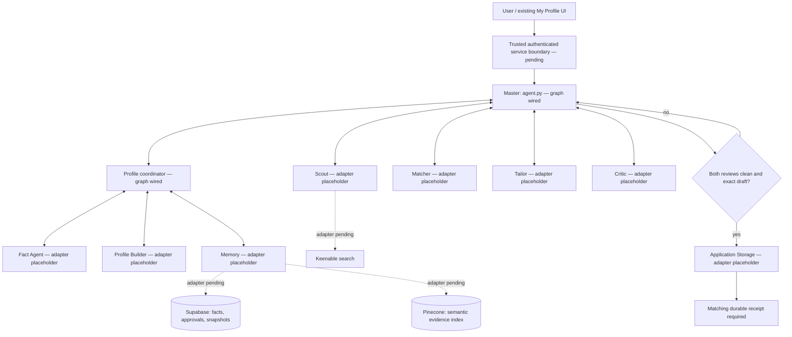

# Python Master / multi-agent architecture

Decision: use the **LangGraph Python SDK**, pinned to 1.2.18, with Pydantic contracts and dependency-injected tools. This is a local backend foundation; hosted version 17 continues to use the existing JS service.

## Why this SDK

| Option | Fit for Career Scout | Decision |
| --- | --- | --- |
| LangGraph | Explicit state, permitted routes, nested coordinators, bounded loops and future durable checkpoints | Use as orchestration runtime |
| LangChain | Convenient model/tool components; can be introduced inside one agent | Optional when a real agent needs its abstraction |
| Deep Agents | Higher-level planning, subagents and filesystem context | Defer until an isolated research task actually needs these capabilities |
| Google GenAI SDK | Direct Gemini model access, separate from routing and storage | Intended provider adapter; implementation pending |

Primary references: [LangGraph overview](https://docs.langchain.com/oss/python/langgraph/overview), [graph API](https://docs.langchain.com/oss/python/langgraph/graph-api), [Deep Agents overview](https://docs.langchain.com/oss/python/deepagents/overview), [Google GenAI libraries](https://ai.google.dev/gemini-api/docs/libraries). LangGraph does not require LangChain model wrappers or OpenAI credentials. No managed LangSmith service is required for this local package. Model/provider quota and charges remain separate from SDK selection.

## Agent hierarchy and storage

Only Master coordinates top-level agents. Only Profile calls Fact, Builder and Memory. Storage is a Master-owned write boundary, not a peer coordinator. Gemini is a model provider used *inside* future adapters, not another top-level agent. It does not replace Supabase, Pinecone or Keenable.

## Execution and approval gates

1. Fresh resume intake: Master → Profile → Fact → Profile → Master. JD text is excluded from Fact input. Every proposal needs an exact source quotation. Return `needs_fact_approval`; do not auto-approve or start job search.
2. Approved snapshot: Master → Profile → Memory. The future Memory adapter must reload the current, owner-scoped approvals from Supabase. The graph rejects version mismatch and malformed/unsupported role references.
3. If roles are missing, Profile → Builder using approved facts and 0–15 optional JDs. Return proposed roles/questions as `needs_role_approval`. Proposed output never becomes an approval inside this graph.
4. Once an approved role is explicitly selected, Master passes only role name, keywords and allowed search preferences to Scout. A `discover` request ends after job discovery; it does not automatically tailor resumes.
5. A `prepare_application` request goes through Matcher → Master → Tailor → Master → Critic → Master. Matcher must select a job from the shortlist. Draft job/profile identity must match.
6. Critic checks factual grounding and job alignment independently, tied to the exact draft SHA-256. Failed reviews return through Master to Tailor, with at most two revisions by default (configurable 0–5).
7. Master rechecks the review before storage. Only a successful receipt matching job, profile version, draft hash and idempotency key produces `ready_to_apply`. No application submission is implemented.

All arrows represent actual local graph routing; provider adapters remain unbound. Editing prompts cannot weaken approval checks, modify scopes or grant tools.

## Tool contracts and next adapters

| Agent | Tool | Typed input → output | Integration to implement |
| --- | --- | --- | --- |
| Fact | `extract_facts` | FactInput → FactOutput | Existing source parsing/Gemini extraction; propose only |
| Profile Builder | `build_profile` | BuilderInput → BuilderOutput | Existing Gemini Builder; separate approved facts/JD requirements |
| Memory | `load_profile` | MemoryInput → ApprovedProfile | Profile-owned Supabase snapshot/current approval validation |
| Scout | `search_jobs` | SearchInput → SearchOutput | Bounded Keenable discovery and structured job packets |
| Matcher | `match_jobs` | MatchInput → MatchOutput | Evidence-based fit assessment and gap explanation |
| Tailor | `tailor_resume` | TailorInput → Draft | Gemini grounded generation with stable job/profile identity |
| Critic | `review_draft` | CriticInput → CriticOutput | Independent grounding/alignment review |
| Application Storage | `save_package` | StorageInput → StorageOutput | Owner-scoped, idempotent durable package write |

Known integration detail: current hosted discovery uses the approved role title and saved filters; Builder keywords are metadata rather than automatically included in Keenable queries. The new Python `SearchInput` explicitly includes keywords. A future Keenable adapter must define and test how those terms enter bounded queries before claiming this feature is live.

Future document parsing, safe JD-link reading, proposal persistence, approval decisions and embedding tools require their own schemas and authorization. They are not silently registered as generic HTTP, filesystem or shell tools. Existing production JS implementations remain the reference for SSRF protection, exact evidence, per-version approvals, CAS updates and private storage.

## Rollout sequence

| Step | State in this change | Exit condition |
| --- | --- | --- |
| 1. SDK, package, prompts and tool schemas | Implemented locally | Offline tests and package checks pass |
| 2. Master and nested Profile routing | Implemented locally | Routing parity with JS policy, scoped payloads and negative gate tests pass |
| 3. Memory and Gemini Profile adapters | Pending | Synthetic contract checks, then representative extraction/build evaluation; no fabricated approvals |
| 4. Scout adapter | Pending | Structured source-backed job packets; keyword/filter behavior and request limits tested |
| 5. Matcher, Tailor, Critic, Storage | Pending | Independent review and durable idempotent storage validated with real adapters |
| 6. Durable service/runtime and web bridge | Pending | Authenticated owner isolation, persistent checkpoints, stale-revision guards, cancellation, recovery and deployment verified |

This document explains the new Python layout; `data/scout-progress.json` remains the authoritative capability/status record. Existing production task statuses must not be marked complete merely because scaffolding and synthetic tests pass. Hosted deployment remains version 17 until separately released.
